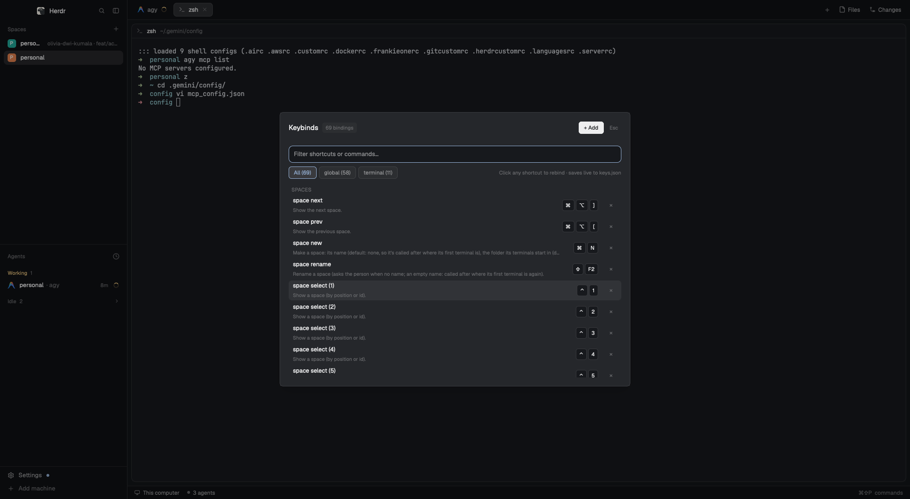

# herdr-keybinds

A visual keybinding editor mod for [Herdr](https://herdr.dev) GUI. Rebind, add, remove, and undo shortcuts in `~/.config/herdr-app/keys.json` with live key capture and instant hot reload—no hand-editing JSON.

## Features

- **Click-to-rebind** with live keystroke capture (`e.keystroke`) and styled keycaps
- **Conflict & safety checks** — prompts before overwriting an existing binding in the same section or binding terminal-reserved chords (`ctrl-c`, `ctrl-d`, etc.), and protects `ctrl-alt-shift-escape`
- **Add & remove bindings** with searchable autocomplete from `commands()`
- **Section tabs & search** across `global`, `terminal`, `layout:*`, and `mod:*`
- **Atomic live saves + Undo** directly to `~/.config/herdr-app/keys.json` (preserves key order and object-valued actions)
- **Theme-native** — follows any light or dark Herdr theme automatically

## Install

Tell your coding agent:

> Read `~/.config/herdr-app/AGENTS.md`, then add this mod: `herdr.dev/mods/abuabdillatief/herdr-keybinds`

Or from GitHub directly:

> Read `~/.config/herdr-app/AGENTS.md`, then add this mod from `https://github.com/abuabdillatief/herdr-keybinds`

Default shortcut: **`Cmd+Shift+K`** (`mod.open:keybinds`).
