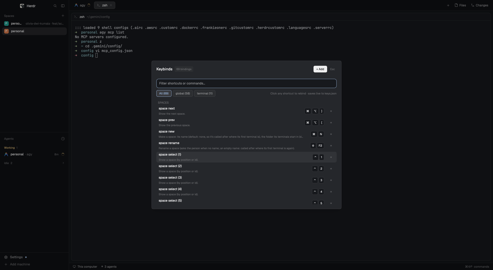

# Keybinds

A visual shortcut editor for Herdr GUI that opens as a centered 740×580 dialog, displays every binding from `~/.config/herdr-app/keys.json` as styled keycaps grouped by category, and lets you rebind, add, remove, or undo shortcuts with live reload—no manual JSON editing required.

## What you see

Top to bottom inside a `theme().popover` container (`18px` padding, `12px` vertical gap, `12.5px` base text):

- **Header (`28px`):** Left side shows `Keybinds` (`15px`, semibold, `foreground`) and a count pill (`raised` background, `11px`, `dim`, e.g. `69 bindings`). Right side shows an optional `Undo` button (visible once edits exist in the session), a primary `+ Add` button (`solid` background, `solid_foreground` text), and an `Esc` close button (`11px`, `dim`).
- **Context banners (conditional):**
  - *Recording banner:* `selected` background, `1px` `accent` border, pulsing `8px` accent dot (`opacity` 0.35→1 over 900ms), prompt text (`Press new shortcut for "…" (<section>)…`), and an `Esc to cancel` button.
  - *Conflict / risky-key banner:* `raised` background, `1px` `blocked` border, warning message, and `Cancel` / `Replace` (or `Bind anyway`) buttons.
  - *Add-shortcut drawer:* `surface` panel with `1px` `input` border containing section pills (`global`, `terminal`, plus any `layout:*`/`mod:*` sections), a command text input with up to 6 clickable autocomplete chips from `commands()`, a clickable key-capture box (`150px` min-width), and an `Add` button.
- **Filter bar:** Full-width `36px` search input (`accent` border, `background` fill) above a row of section filter pills (`All (N)`, `global (N)`, `terminal (N)`, etc.) on the left and a right-aligned status line (`dim` hint by default, `done` green on save, `blocked` amber on error).
- **Bindings list (`flex_1`, scrollable):** Grouped under uppercase `11px` `dim` headers (`SPACES`, `TABS`, `PANES`, `AGENTS`, `TERMINAL`, `LAYOUT & APP`, `CUSTOM`). Each `42px` row shows the formatted action title (`12.5px`, medium, `foreground`), a non-global section tag if applicable, the command's description from `commands()` (`10.5px`, `dim`), clickable rounded keycaps (`background` fill, `1px` `input` border; macOS symbols `⌘ ⌥ ⌃ ⇧` on macOS, text labels elsewhere), and a `24×24` `×` remove button.

## How it behaves

- **Open / close:** Bound to `cmd-shift-k` (`mod.open:keybinds`) in `keys.json`. Pressing `Esc` cancels active key recording, dismisses a conflict banner, closes the Add drawer, or closes the dialog.
- **Filter:** Typing in the search bar filters live across keystroke text, formatted action label, raw command name, section name, and command description. Clicking a section pill narrows to that section.
- **Rebind:** Clicking any row's keycaps focuses a hidden capture handle (`captureHandle`) and enters recording mode. Pressing any non-modifier chord captures `e.keystroke` directly:
  - Pressing the same keystroke cancels cleanly with `"Unchanged"`.
  - Pressing `ctrl-alt-shift-escape` is rejected because it is Herdr's built-in escape hatch.
  - If the keystroke is already bound in the same section, an inline conflict banner asks to `Replace` or `Cancel`.
  - If the keystroke is a terminal-critical chord (`ctrl-c`, `ctrl-d`, `ctrl-l`, `ctrl-r`, `ctrl-w`, `ctrl-a`, `ctrl-e`, `ctrl-u`, `ctrl-k`, `ctrl-z`, `ctrl-[`) in `global` or `terminal`, an inline warning asks to `Bind anyway` or `Cancel`.
  - Otherwise it replaces the key in-place (preserving section key order and object-valued actions), writes `~/.config/herdr-app/keys.json` atomically, and Herdr hot-reloads the shortcut immediately.
- **Add / Remove / Undo:** `+ Add` lets you pick a section, type or click a command suggestion, record a key chord, and append it to `keys.json`. Clicking `×` removes a binding. Every save pushes the prior `keys.json` snapshot onto an in-memory undo stack (up to 30 entries) restored by `Undo`.

## Built from

- `mods/keybinds/mod.json` — `{ "place": "none", "overlay": { "width": 740, "height": 580 } }`
- `mods/keybinds/main.js` — single GPUI-Kit `View` (`Keybinds`) using `div`, `v_flex`, `h_flex`, `InputState`, and `Input`.
- `keys.json` — binds `cmd-shift-k` in `global` to `mod.open:keybinds`.
- `herdr` imports: `appHome`, `checking`, `closeOverlay`, `commands`, `props`, `readTextFile`, `theme`, `window`, `writeTextFile`. Does not call `exec`, `hc`, or `fetch`, and only reads/writes `~/.config/herdr-app/keys.json`.

## Watch out

- **No `"transparent"` color literal:** GPUI-Kit rejects `"transparent"` at render time; use `"#00000000"` for transparent backgrounds and borders.
- **Keys containing `-` (e.g. `cmd--` for zoom out):** Naive `keystroke.split("-")` breaks on `cmd--`. Strip known modifier prefixes (`cmd`, `ctrl`, `alt`, `shift`, `super`) from the front and keep the remainder as the key token.
- **Bare modifier keypresses:** Ignore modifier-only `on_key_down` events (`shift`, `control`, `alt`, `cmd`, `super`, `meta`, `fn`, `capslock`) and repeated held events (`e.is_held`) while recording.
- **Separate focus handle for recording:** Keep a dedicated `captureHandle` so recorded chords do not type into the search or command inputs.
- **Object actions in `keys.json`:** Bindings can be `{ "command": "...", "args": {...} }` as well as strings; preserve the raw value on rebind instead of stringifying it.
- **Atomic writes and `checking()`:** Guard `readTextFile` in `init()` with `if (checking())` (seeding sample data so `herdr-app check` still renders rows). Pass the previous file text to `writeTextFile(path, next, expected)` and reload on stale-snapshot rejection.

## Done when

- `herdr-app check ~/.config/herdr-app/mods/keybinds` exits 0 with `check passed`.
- Opening `mod.open:keybinds` renders all sections and bindings from `keys.json` with zero errors in `herdr-app status`.
- Clicking a binding, pressing a new chord, and checking `keys.json` updates the key in-place and applies live in Herdr.
- Pressing a conflicting key or `ctrl-c` prompts for confirmation before writing; pressing `Undo` restores the previous `keys.json`.
